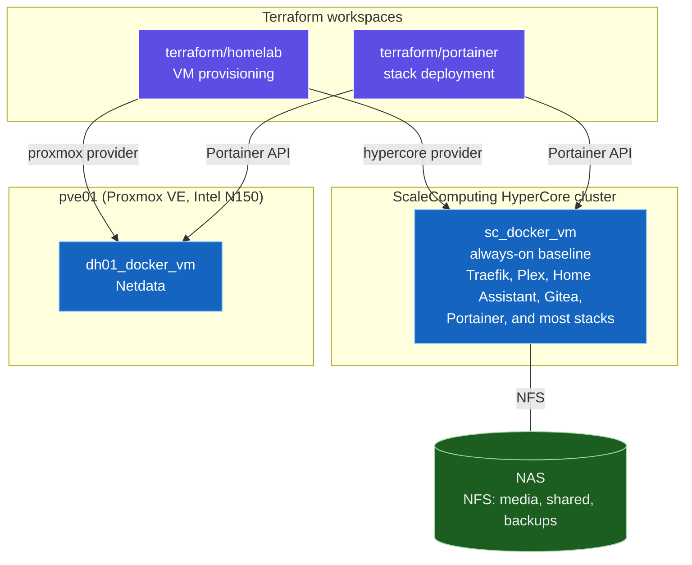
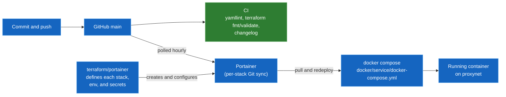
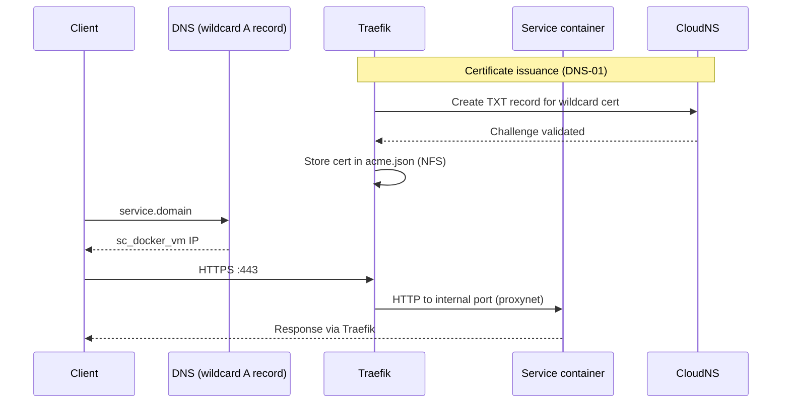
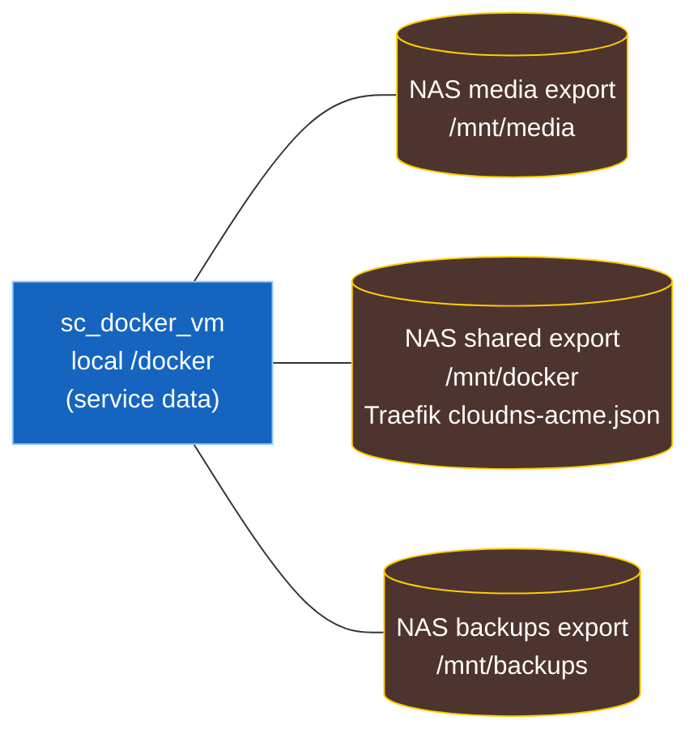

# Architecture

Diagrams are Mermaid, which renders natively on github.com. Terms are defined in [GLOSSARY.md](../GLOSSARY.md); the reasoning behind each choice is in [docs/adr/](adr/) and [resilience-planning.md](resilience-planning.md).

## Hosts and infrastructure

Terraform provisions two Docker VMs and then deploys stacks onto them through Portainer.

## GitOps deploy flow

A commit to `main` reaches the running containers through Portainer polling, with no manual deploy step.

## Request path and TLS

## Storage

`sc_docker_vm` keeps service data on its local `/docker` disk and mounts three NAS NFS exports through cloud-init.

## Failover (planned)

Failover and replication are described as a design in [resilience-planning.md](resilience-planning.md). It is a plan and not a record of what is deployed, so it is not diagrammed here.
