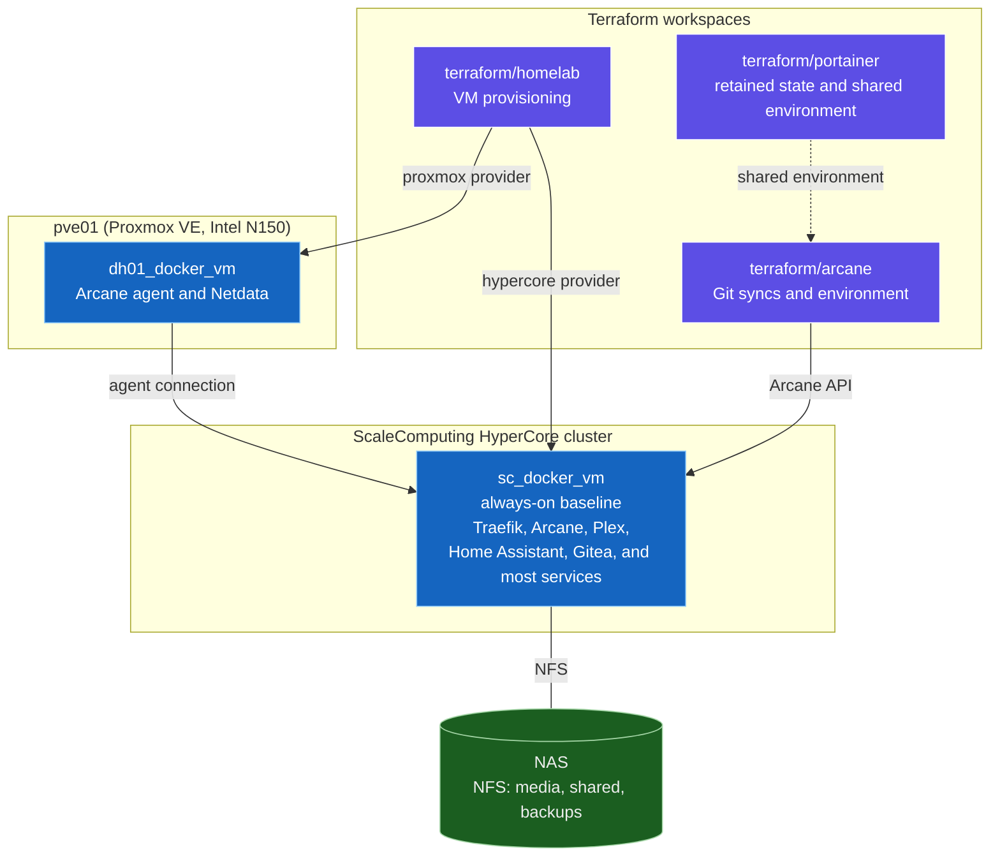
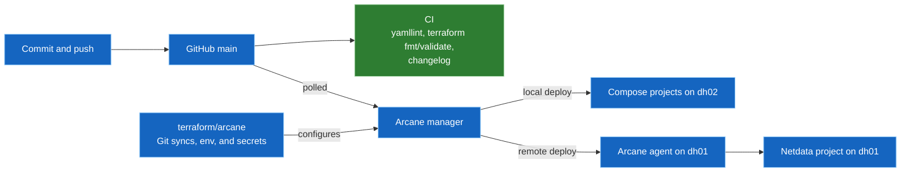
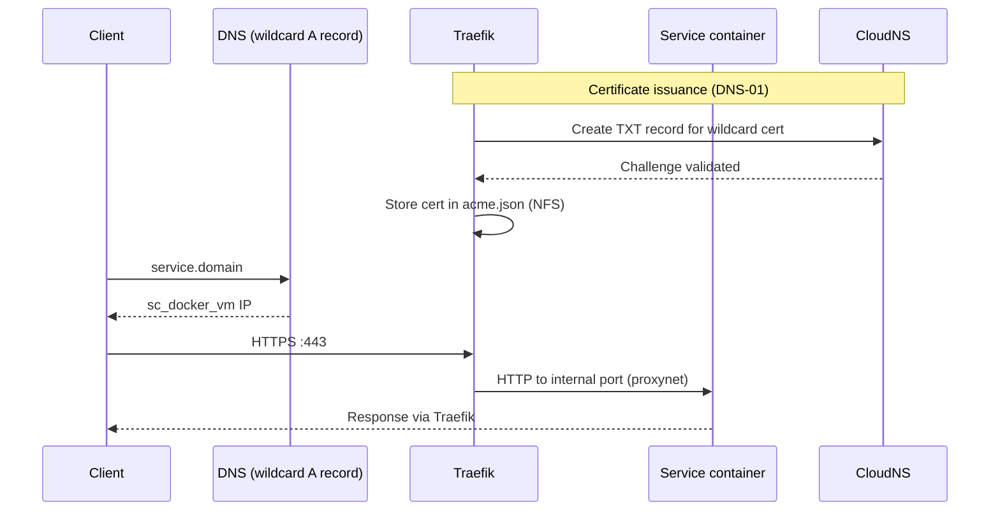
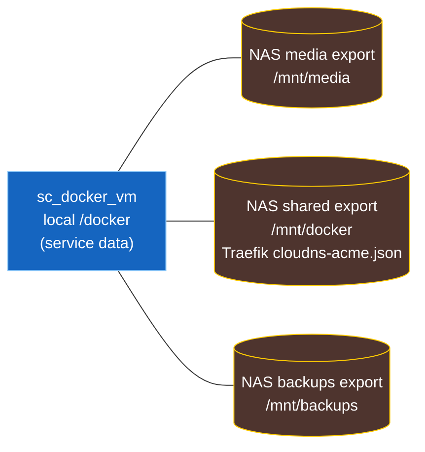

# Architecture

Diagrams are Mermaid, which renders natively on github.com. Terms are defined in [GLOSSARY.md](../GLOSSARY.md); the reasoning behind each choice is in [docs/adr/](adr/) and [resilience-planning.md](resilience-planning.md).

## Hosts and infrastructure

Terraform provisions two Docker VMs. Arcane manages the migrated application
projects on dh02 and Netdata on dh01 through its remote agent. The Portainer
manager and dh01 Portainer agent are stopped and retained for rollback.

## GitOps deploy flow

A commit to `main` reaches running containers through manager polling, with no
manual deploy step. Arcane polls Git and deploys projects locally on dh02 or
through its dh01 agent. The manager and agent are bootstrapped independently
of these Git syncs.

## Request path and TLS

## Storage

`sc_docker_vm` keeps service data on its local `/docker` disk and mounts three NAS NFS exports through cloud-init.

## Failover (planned)

Failover and replication are described as a design in [resilience-planning.md](resilience-planning.md). It is a plan and not a record of what is deployed, so it is not diagrammed here.
